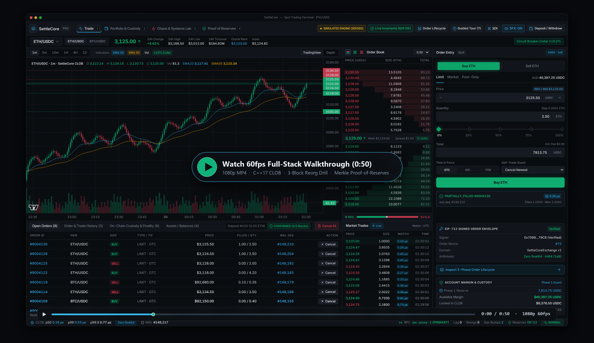
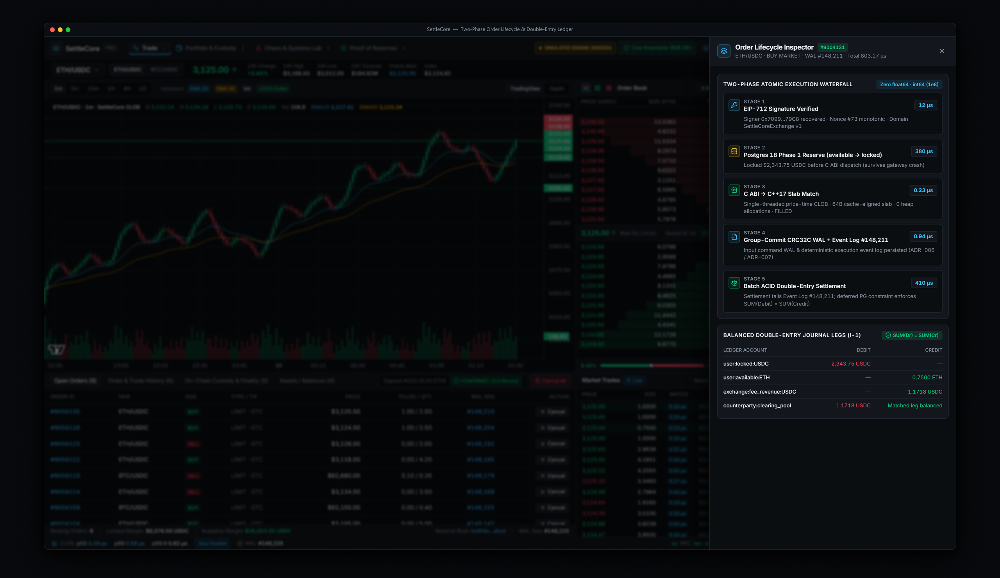
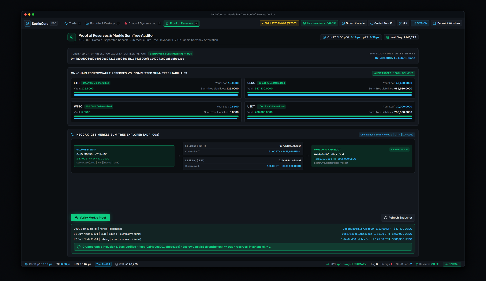
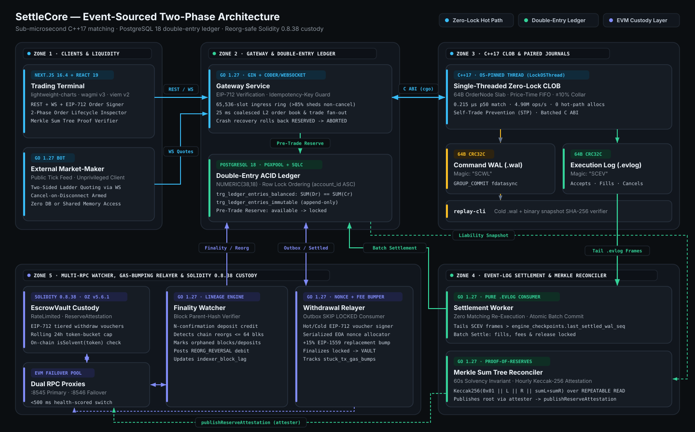
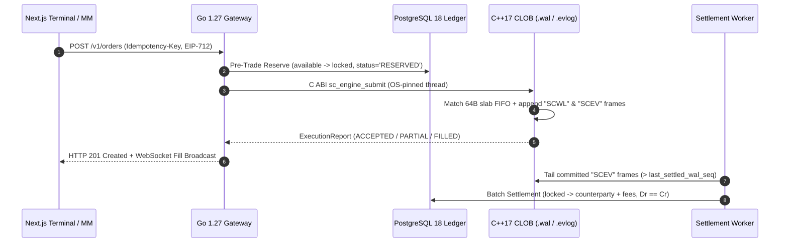
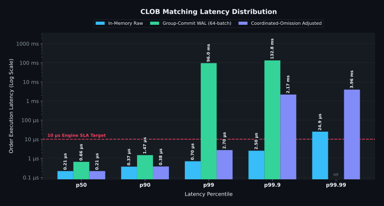
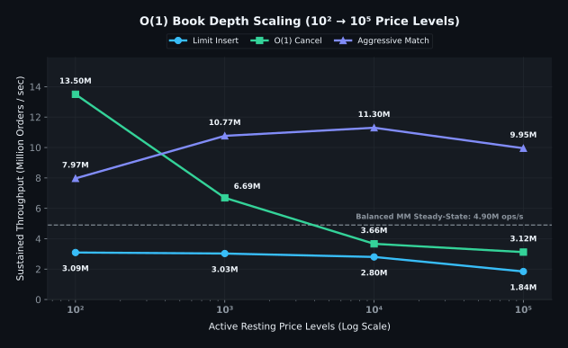
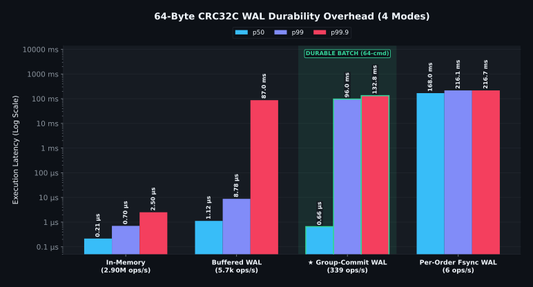

# SettleCore

[](.github/workflows/ci.yml)
[](contracts/test/EscrowVault.invariant.t.sol)
[](engine/tests/order_book_test.cpp)
[](services/internal/sim/simulator_test.go)
[](LICENSE)

**SettleCore** is a hybrid spot exchange combining an event-sourced **C++17 single-threaded, zero-lock hot path** Central Limit Order Book (`0.215 µs` median match, `0` hot-path heap allocations), a **Go 1.27** double-entry **PostgreSQL 18** ledger with database-enforced conservation triggers, a reorg-safe EVM indexer/relayer, and a **128-LOC Solidity 0.8.38 `EscrowVault`** built on OpenZeppelin Contracts `v5.6.1` (`SafeERC20`, `EIP712`, `ECDSA`, `ReentrancyGuard`, `Ownable`) paired with a continuous rolling 24-hour token-bucket rate limiter and on-chain **Merkle Sum Tree** solvency verification (`isSolvent(token)`).

Because each market's CLOB executes on a dedicated OS-pinned thread (`runtime.LockOSThread()`), the matching loop requires **zero mutexes, zero spinlocks, and zero atomic CAS contention** on the order book—emitting both a 64-byte CRC32C Input Command WAL (`"SCWL"`) and a 64-byte Output Execution Event Log (`"SCEV"`) so `settlement` settles trades as a pure event consumer without re-running matching.

<p align="center">
  <a href="docs/assets/media/settlecore-launch.mp4">
    
  </a>
</p>

<p align="center">
  <a href="docs/assets/media/settlecore-launch.mp4">▶ Watch 60fps 1080p Launch Walkthrough (MP4)</a>
</p>

<details>
<summary>▶ Inline Video Player (1080p @ 60fps MP4)</summary>

<video src="docs/assets/media/settlecore-launch.mp4" controls muted playsinline width="100%"></video>

</details>

---

## Features

- **Sub-Microsecond C++17 Limit Order Book & Group-Commit WAL** ([`engine/`](engine/include/settlecore/order_book.hpp)): Single-threaded price-time priority matching (`int64_t` fixed-point ticks/lots, `__int128_t` notional valuation) over a pre-allocated 64-byte cache-aligned `OrderNode` slab, per-symbol reference-price collar circuit breaker ([`circuit_breaker.cpp`](engine/src/circuit_breaker.cpp)), batched C-ABI FFI (`sc_engine_submit_batch` in [`c_api.cpp`](engine/src/c_api.cpp)), 64-byte `"SCWL"` Write-Ahead Log with Group-Commit (`WalMode::GROUP_COMMIT` in [`wal.cpp`](engine/src/wal.cpp)), and deterministic `"SCEV"` outbound execution event logs.
- **Two-Phase ACID Double-Entry Ledger & Event-Sourced Settlement** ([`services/internal/ledger/`](services/internal/ledger/ledger.go), [`services/cmd/settlement/`](services/cmd/settlement/main.go)): Strictly balanced PostgreSQL 18 double-entry accounting (`SUM(debit) == SUM(credit)` enforced by deferred constraint trigger `trg_ledger_entries_balanced` and append-only trigger `trg_ledger_entries_immutable` in [`000001_init_ledger_and_accounts.up.sql`](services/migrations/000001_init_ledger_and_accounts.up.sql)), reserving funds prior to matching and settling maker/taker fills plus fee credits atomically via the asynchronous `.evlog` settlement consumer.
- **Multi-RPC EVM Finality Watcher & Self-Healing Gas-Bumping Relayer** ([`services/internal/evm/`](services/internal/evm/watcher.go)): Parent-hash lineage verification across a configurable reorg window ([`reorg.go`](services/internal/evm/reorg.go)), automatic N-block reorg detection with atomic `REORG_REVERSAL` compensating journal entries, sub-second multi-RPC failover ([`rpc_pool.go`](services/internal/evm/rpc_pool.go)), serialized EOA nonce allocation ([`relayer.go`](services/internal/evm/relayer.go)), and EIP-1559 replacement transaction gas bumping (`+15%` fee escalation in [`gas_bumper.go`](services/internal/evm/gas_bumper.go)).
- **Tiered EIP-712 On-Chain Custody & Merkle Sum Tree Proof-of-Reserves** ([`contracts/`](contracts/src/EscrowVault.sol), [`services/internal/reconciler/`](services/internal/reconciler/merkle.go)): Non-upgradeable `EscrowVault.sol` with EIP-712 typed withdrawal vouchers, continuous 24-hour rolling token-bucket withdrawal limiter ([`RateLimited.sol`](contracts/src/RateLimited.sol)), separated [`ReserveAttestation.sol`](contracts/src/ReserveAttestation.sol) attester role with on-chain `isSolvent(token)` invariant check, and non-negative leaf-sorted Merkle Sum Tree liability proofs.
- **Real-Time Institutional Spot Trading Terminal** ([`web/`](web/src/app/page.tsx)): High-density TradingView candlestick chart ([`CandlestickChart.tsx`](web/src/components/CandlestickChart.tsx)) with EMA-20 and ±10% circuit-breaker collar bands, flash-animated L2 depth order book ([`OrderBook.tsx`](web/src/components/OrderBook.tsx)), two-phase order lifecycle & double-entry ledger inspector drawer ([`OrderLifecycleDrawer.tsx`](web/src/components/OrderLifecycleDrawer.tsx)), and interactive Merkle Sum Tree inclusion proof verifier ([`ProofOfReservesModal.tsx`](web/src/components/ProofOfReservesModal.tsx)).

<p align="center">
  
  
</p>

---

## System Architecture

<p align="center">
  <picture>
    <source media="(prefers-color-scheme: dark)" srcset="docs/assets/architecture/system-topology-dark.svg" />
    <source media="(prefers-color-scheme: light)" srcset="docs/assets/architecture/system-topology-light.svg" />
    
  </picture>
</p>

### Two-Phase Order Lifecycle



1. **Pre-Trade Reservation (`Gateway -> PostgreSQL 18`):** `POST /v1/orders` optionally verifies the user's EIP-712 signature ([`eip712_orders.go`](services/internal/gateway/eip712_orders.go)), locks the user's `accounts` row (`FOR UPDATE`), checks `Idempotency-Key`, and moves worst-case obligation from `available` to `locked` (`status = 'RESERVED'`). If the gateway crashes prior to WAL append, [`recovery.go`](services/internal/gateway/recovery.go) rolls `RESERVED` orders back to `ABORTED_UNSUBMITTED`.
2. **Deterministic Matching & Paired Journals (`Go cgo -> C++17 CLOB`):** A single OS-pinned thread drains the `65,536`-slot ingress ring (shedding non-cancel traffic above `85%` utilization) and invokes `sc_engine_submit` / `sc_engine_submit_batch` in [`c_api.cpp`](engine/src/c_api.cpp). Each command writes a 64-byte CRC32C `"SCWL"` frame and emits 64-byte CRC32C `"SCEV"` execution events (`ORDER_ACCEPTED`, `TRADE_FILL`, `ORDER_CANCELED`, `ORDER_REJECTED`) to `.evlog`.
3. **Pure-Consumer Batch Settlement (`Settlement Worker -> PostgreSQL 18`):** [`settlement/main.go`](services/cmd/settlement/main.go) tails `.evlog` frames (`wal_seq > engine_checkpoints.last_settled_wal_seq`), locks affected accounts in ascending `account_id` order, posts balanced double-entry journal rows checked at commit by `trg_ledger_entries_balanced`, and advances `last_settled_wal_seq`.

---

## Benchmarks

> **Hardware & Environment Disclosure:** Measured inside WSL2 (`Ubuntu-24.04`) on an 8-core `3.30 GHz` host (`12 MiB` L3), compiled with `cmake --preset release` (`-O3 -DNDEBUG`) and pinned to core `2` (`taskset -c 2`). Tail-latency histograms use `HdrHistogram_c` (`v0.12.1`) with `100,000` warm-up orders and **open-loop arrival-rate pacing** (`500,000 ops/sec`, `hdr_record_corrected_value`) to capture queueing delay without coordinated omission. Disk-backed WAL modes (`buffered_wal`, `group_commit_wal`, `fsync_wal`) reflect **virtualized WSL2 storage `fdatasync` latency** (`~168 ms` per physical sync), not bare-metal NVMe.

<p align="center">
  <picture>
    <source media="(prefers-color-scheme: dark)" srcset="docs/assets/benchmarks/latency-percentiles-dark.svg" />
    <source media="(prefers-color-scheme: light)" srcset="docs/assets/benchmarks/latency-percentiles-light.svg" />
    
  </picture>
</p>

<p align="center">
  <picture>
    <source media="(prefers-color-scheme: dark)" srcset="docs/assets/benchmarks/throughput-vs-depth-dark.svg" />
    <source media="(prefers-color-scheme: light)" srcset="docs/assets/benchmarks/throughput-vs-depth-light.svg" />
    
  </picture>
  <picture>
    <source media="(prefers-color-scheme: dark)" srcset="docs/assets/benchmarks/wal-overhead-dark.svg" />
    <source media="(prefers-color-scheme: light)" srcset="docs/assets/benchmarks/wal-overhead-light.svg" />
    
  </picture>
</p>

### Open-Loop Tail-Latency Percentiles (`benchmarks/results/latency_percentiles.csv`)

| Percentile | Raw Service Latency (ns / µs) | Open-Loop CO-Corrected Latency (µs) | Sample Count (Raw / CO) |
| :---: | :---: | :---: | :---: |
| **`p50`** | `215 ns` (`0.215 µs`) | `0.215 µs` | `1,000,000` / `1,009,448` |
| **`p90`** | `367 ns` (`0.367 µs`) | `0.375 µs` | `1,000,000` / `1,009,448` |
| **`p99`** | `703 ns` (`0.703 µs`) | `2.703 µs` | `1,000,000` / `1,009,448` |
| **`p99.9`** | `2,503 ns` (`2.503 µs`) | `2,172.927 µs` | `1,000,000` / `1,009,448` |
| **`p99.99`** | `24,911 ns` (`24.911 µs`) | `3,956.735 µs` | `1,000,000` / `1,009,448` |

### Four-Mode WAL Durability & Group-Commit Comparison (`benchmarks/results/wal_overhead.csv`)

| Persistence Mode (`W4`) | Durability Contract | `p50` (µs) | `p99` (µs) | `p99.9` (µs) | Throughput (orders/sec) |
| :--- | :--- | :---: | :---: | :---: | :---: |
| **`in_memory`** | Zero disk I/O (baseline data-structure speed) | `0.215` | `0.703` | `2.503` | `2,895,287` |
| **`buffered_wal`** | `write(2)` + periodic `fdatasync` / `1,024` frames (acks *before* sync) | `1.119` | `8.783` | `86,966.271` | `5,699` |
| **`group_commit_wal`** | Batch `64` cmds per `fdatasync` covering `.wal` + `.evlog` (**acks only *after* sync**) | `0.655` | `96,010.239` | `132,775.935` | `339` (`56×` durable `fsync_wal`) |
| **`fsync_wal`** | Synchronous `fdatasync` on every single command | `168,034.303` | `216,137.727` | `216,662.015` | `6` |

### Throughput & Depth Scaling (`benchmarks/results/clob_bench.json`)

| Benchmark (`clob_bench`) | Active Levels / Sweep Size | Mean CPU Time (ns) | Sustained Throughput (orders/sec) |
| :--- | :---: | :---: | :---: |
| **`BM_W1_BalancedMarketMaker`** (`55%` Limit, `35%` Cancel, `10%` Match) | Steady State | `204.14` | `4,898,680` (`4.90M/s`) |
| **`BM_W2_DepthScaling_LimitInsert`** | `100` / `1,000` / `10,000` / `100,000` | `323.45` / `330.57` / `357.21` / `542.72` | `3.09M` / `3.03M` / `2.80M` / `1.84M` |
| **`BM_W2_DepthScaling_Cancel`** | `100` / `1,000` / `10,000` / `100,000` | `74.07` / `149.49` / `272.96` / `320.68` | `13.50M` / `6.69M` / `3.66M` / `3.12M` |
| **`BM_W2_DepthScaling_AggressiveMatch`** | `100` / `1,000` / `10,000` / `100,000` | `125.51` / `92.88` / `88.50` / `100.49` | `7.97M` / `10.77M` / `11.30M` / `9.95M` |
| **`BM_W3_DeepBookSweep`** | `1` / `10` / `50` / `250` levels | `241.71` / `695.65` / `2,981.98` / `16,869.94` | `4.14M` / `1.44M` / `335.35K` / `59.28K` |

Raw outputs are committed in [`latency_percentiles.csv`](benchmarks/results/latency_percentiles.csv), [`wal_overhead.csv`](benchmarks/results/wal_overhead.csv), and [`clob_bench.json`](benchmarks/results/clob_bench.json). See [docs/benchmarking.md](docs/benchmarking.md) for chart regeneration.

---

## Quickstart

```bash
# Start full local stack (PostgreSQL 18, Anvil, Dual RPC Proxies, Go Services, Next.js UI, Prometheus, Grafana)
make up

# Run Foundry (20/20), C++17 ASan+UBSan (21/21), and Go -race (differential + 100-seed sim + E2E) suites
make test

# Build Next.js 16.4 UI and run repository-wide static checks
make build-web && make lint

# Run C++17 Release benchmarks and regenerate dark/light SVGs in docs/assets/benchmarks/
make bench && make bench-charts
```

---

## Operational Scope & Limitations

- **External Audit & Key Custody:** SettleCore is a reference exchange system; production deployment requires an independent smart-contract and cryptographic audit alongside HSM/MPC key custody for `coldSigner` and `attester`.
- **Target Network & Liquidity:** Default scripts target local Anvil (`chainId = 31337`) or Sepolia with a standalone Go market-maker bot.
- **Static Demo Mode:** When `NEXT_PUBLIC_DEMO_MODE=1` (`NEXT_PUBLIC_STATIC_EXPORT=1`), the browser runs a seeded deterministic client simulation ([`web/src/lib/demo.ts`](web/src/lib/demo.ts)) indicated by the `SIMULATED ENGINE (SEEDED)` badge; engine benchmarks are measured from the native C++17 binary.

---

## Technical Documentation & Architecture Decision Records

- **Specifications:**
  - [System Architecture & Sequence Diagrams](docs/architecture.md)
  - [PostgreSQL 18 Database Schema & Triggers](docs/database-schema.md)
  - [REST & `coder/websocket` API Specification](docs/api-spec.md)
  - [Benchmarking & Automated SVG Chart Pipeline](docs/benchmarking.md)
  - [Chaos Engineering & Verification Pyramid](docs/chaos-and-testing.md)
  - [Security Threat Model & Formal Invariants](docs/security-and-invariants.md) · [SECURITY.md](SECURITY.md) · [CHANGELOG.md](CHANGELOG.md)
- **Architecture Decision Records ([`docs/adr/`](docs/adr/README.md)):**
  - [ADR-001: Fixed-Point Arithmetic and Multi-Decimal Asset Normalization](docs/adr/ADR-001-fixed-point-arithmetic-and-decimal-normalization.md)
  - [ADR-002: Single-Threaded Zero-Lock Hot Path C++17 CLOB and Flat C ABI Boundary](docs/adr/ADR-002-cpp17-clob-and-go-c-abi-boundary.md)
  - [ADR-003: PostgreSQL 18 Double-Entry Ledger and Two-Phase Order Settlement](docs/adr/ADR-003-double-entry-ledger-and-two-phase-settlement.md)
  - [ADR-004: Reorg-Safe EVM Indexing, Multi-RPC Failover, and Tiered EIP-712 Custody](docs/adr/ADR-004-reorg-safe-evm-indexing-and-tiered-custody.md)
  - [ADR-005: Binary WAL Framing, Deterministic Replay, and Merkle Proof-of-Reserves](docs/adr/ADR-005-deterministic-wal-replay-and-merkle-solvency.md)
  - [ADR-006: Event-Sourced Core and Execution Event Log (`"SCEV"`)](docs/adr/ADR-006-event-sourced-core-and-execution-event-log.md)
  - [ADR-007: WAL Durability Contract and Group-Commit Amortization](docs/adr/ADR-007-wal-durability-contract-and-group-commit.md)
  - [ADR-008: Merkle Sum Tree Proof-of-Reserves and On-Chain `isSolvent`](docs/adr/ADR-008-merkle-sum-tree-proof-of-reserves.md)
  - [ADR-009: Rolling Token-Bucket Withdrawal Limiter and Role Separation](docs/adr/ADR-009-rolling-token-bucket-withdrawal-limiter.md)
  - [ADR-010: Deterministic Simulation Testing (`services/internal/sim`)](docs/adr/ADR-010-deterministic-simulation-testing.md)

## License

Released under the [MIT License](LICENSE).
