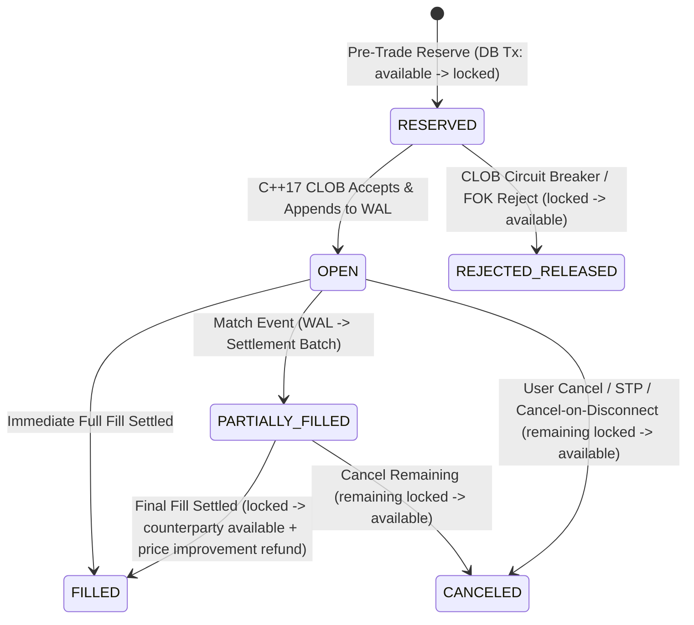

# ADR-003: PostgreSQL 18 Double-Entry Ledger and Two-Phase Order Settlement

- **Status:** Accepted
- **Date:** 2026-11-20
- **Scope:** `services/internal/ledger/`, `services/cmd/settlement/`, `services/migrations/`

## 1. Context

A hybrid exchange splits execution across two storage tiers with different latency and durability characteristics:
1. **In-Memory C++17 CLOB + Binary WAL:** Processes orders in single-digit microseconds.
2. **PostgreSQL 18 Relational Ledger:** Enforces durable multi-account balance conservation, deposit/withdrawal custody state, and auditability.

Executing a synchronous multi-row PostgreSQL transaction *during* every match fill inside the CLOB loop would cap matching throughput at $\sim 2,000\text{ orders/sec}$ and block the order book on database I/O. Conversely, accepting orders into the CLOB without pre-locking funds in the database allows under-funded orders (naked shorting / double-spending across concurrent requests).

## 2. Decision

SettleCore implements a **Two-Phase Reservation & Asynchronous Batch Settlement** architecture backed by an immutable PostgreSQL 18 double-entry journal:

1. **Account Sub-Balances (`available` vs. `locked`):** Every `(user_id, asset)` account tracks `available` (free to trade or withdraw) and `locked` (reserved by active resting orders or pending withdrawals), constrained by `CHECK (available >= 0 AND locked >= 0)`.
2. **Stage 1 — Synchronous Pre-Trade Reserve (`available -> locked`):** Before an order crosses the C ABI into the C++17 CLOB, the Gateway atomically moves the required maximum obligation from `available` to `locked` and inserts the order record with `status = 'RESERVED'` and an idempotency key.
3. **Stage 2 — Asynchronous WAL-Synced Batch Settlement (`locked -> counterparty available`):** The `settlement` worker tails committed fill batches and cancellation events from the engine WAL stream, sorts all affected `account_id` rows in ascending UUID order to eliminate deadlocks, and commits balanced double-entry journal rows (`ledger_entries`) alongside the highest processed `wal_seq` checkpoint in a single ACID transaction.

## 3. Exact Specification

### 3.1 Double-Entry Conservation Equation

Every economic event (deposit confirmation, order reserve, trade settlement, fee collection, order cancel refund, withdrawal lock, withdrawal finalization) creates a `journal_tx_id` with $N \ge 2$ rows in `ledger_entries` such that for each asset $a \in \{\text{ETH}, \text{USDC}, \text{WBTC}, \text{USDT}\}$:

$$\sum_{i=1}^{N} \text{credit}_{i,a} - \sum_{i=1}^{N} \text{debit}_{i,a} = 0$$

System omnibus accounts (`SYSTEM_ESCROW_VAULT`, `SYSTEM_FEE_TREASURY`) represent on-chain custody holdings and exchange fee revenue so the global sum across all user and system accounts is identically zero at every committed transaction boundary:

$$\forall a:\quad \sum_{u \in \text{Users}} \left(\text{available}_{u,a} + \text{locked}_{u,a}\right) + \text{available}_{\text{FEE},a} = \text{liability}_{\text{VAULT},a}$$

### 3.2 Two-Phase State Machine

### 3.3 Deadlock-Free Batch Settlement Protocol

The `settlement` worker batches up to $M = 256$ fills or $5\,\text{ms}$ of WAL entries into a single PostgreSQL 18 transaction:

1. Read `last_settled_wal_seq` from `engine_checkpoints WHERE market_id = $1 FOR UPDATE`.
2. Discard any WAL event with `wal_seq <= last_settled_wal_seq` (idempotent replay guarantee).
3. Collect the distinct set of all affected `(user_id, asset)` account keys across all fills and cancellations in the batch, sort them deterministically by `account_id ASC`, and acquire row locks via `SELECT account_id, available, locked FROM accounts WHERE account_id = ANY($1) ORDER BY account_id ASC FOR UPDATE`.
4. Bulk-insert balanced debit/credit rows into `ledger_entries`, insert trade records into `trades`, update `orders.filled_qty` and `orders.status`, apply net delta updates to `accounts.available` and `accounts.locked`, and advance `engine_checkpoints.last_settled_wal_seq = batch_max_wal_seq`.

## 4. Alternatives Considered

1. **Synchronous In-Transaction Matching and Settlement:** Rejected. Limits throughput to PostgreSQL row-lock contention on top-of-book market makers ($\le 1,500\text{ TPS}$) and exposes the matching engine to database connection pool jitter.
2. **Purely In-Memory Balances with Periodic Postgres Flushing:** Rejected. A gateway crash before Postgres flush could allow a user to initiate a withdrawal or place an order against unpersisted state without database-level double-entry constraints.

## 5. Trade-offs & Failure Modes

- **Settlement Lag Window ($1\text{--}10\,\text{ms}$):** When Maker A's resting order is filled in the C++17 CLOB at $t_0$, the credited asset becomes visible in PostgreSQL `accounts.available` at $t_0 + \Delta_{\text{settle}}$ ($\le 5\,\text{ms}$). During $\Delta_{\text{settle}}$, the seller cannot yet withdraw the newly acquired proceeds, though their filled order is immediately removed from the CLOB.
- **Gateway Crash Between Pre-Trade DB Reserve and CLOB WAL Append:** On restart, the recovery coordinator compares `orders WHERE status = 'RESERVED'` against the C++17 WAL sequence index. Any `RESERVED` order absent from the WAL is deterministically rolled back (`locked -> available`, `status = 'ABORTED_UNSUBMITTED'`).
