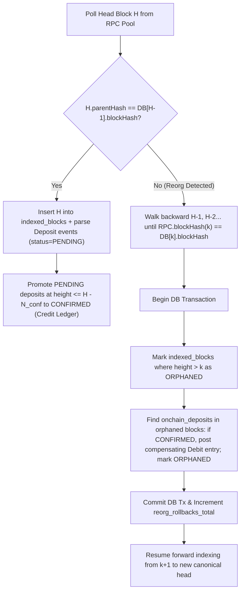

# ADR-004: Reorg-Safe EVM Indexing, Multi-RPC Failover, and Tiered EIP-712 Custody

- **Status:** Accepted
- **Date:** 2026-11-20
- **Scope:** `contracts/src/EscrowVault.sol`, `services/internal/evm/`

## 1. Context

Connecting an off-chain exchange ledger to an EVM chain introduces four critical failure domains:
1. **Chain Reorganizations (Reorgs):** Crediting a deposit as soon as it appears in block $H$ allows an attacker or transient consensus split to orphan block $H$ after the user trades or withdraws against the credited funds.
2. **RPC Node Outages & Stale Heads:** Single-endpoint JSON-RPC watchers stall or ingest stale forks when an upstream provider rate-limits, drops WebSocket connections, or lags behind consensus head.
3. **Hot-Key Compromise:** If an exchange signs withdrawals on-chain with a single hot key that has unlimited access to vault reserves, a single key compromise drains 100% of customer assets.
4. **Non-Standard ERC-20 Implementations (`USDT`):** Tether (`USDT`) on Ethereum omits the `bool` return value on `transfer` and `transferFrom`, causing standard Solidity `IERC20(token).transfer(...)` ABI decoding to revert on every deposit or withdrawal.

## 2. Decision

1. **Lineage-Verified Block Indexing & $N$-Confirmation Finality:** The `watcher` persists every indexed block header (`block_number`, `block_hash`, `parent_hash`) in `indexed_blocks`. Every newly polled block $H$ must satisfy `H.parent_hash == indexed_blocks[H-1].block_hash`. Deposits enter as `PENDING` and transition to `CONFIRMED` (triggering the double-entry credit to `accounts.available`) only when $H_{\text{head}} - H_{\text{deposit}} \ge N_{\text{conf}}$ (default $N_{\text{conf}} = 3$ local / $12\text{--}64$ production).
2. **Deterministic Parent-Hash Reorg Rollback:** When a parent-hash mismatch is detected at height $H$, the `watcher` walks backward along the canonical chain until it finds the common ancestor $H_{\text{fork}}$, marks all `indexed_blocks` above $H_{\text{fork}}$ as `ORPHANED`, and atomically reverses any deposit credits from orphaned blocks inside a single PostgreSQL 18 transaction while incrementing `reorg_rollbacks_total`.
3. **Health-Scored Multi-RPC Failover Pool:** `internal/evm/rpc_pool.go` maintains active health probes across primary and fallback RPC endpoints (`rpc-proxy-1`, `rpc-proxy-2`), failing over automatically in $< 500\,\text{ms}$ on connection errors, HTTP `429`/`5xx`, or head lag $> 2$ blocks.
4. **Tiered On-Chain EIP-712 Hot/Cold Custody (OpenZeppelin Contracts v5 `v5.6.1` + Custom Rolling Token-Bucket Limiter):** `EscrowVault.sol` (128 LOC, composed with `RateLimited.sol` and `ReserveAttestation.sol`) uses OpenZeppelin Contracts `v5.6.1` (`SafeERC20`, `EIP712`, `ECDSA`, `ReentrancyGuard`, `Ownable`) paired with SettleCore's hand-written **continuous rolling 24-hour token-bucket rate limiter** (OpenZeppelin `v5.6.1` does not ship a `RateLimiter` contract) to enforce two cryptographic tiers:
   - **Hot Tier (`hotSigner`):** Valid for single withdrawals below `hotPerTxCap[token]` and subject to the continuous rolling 24-hour token-bucket budget (`hotDailyCap[token]` in `RateLimited.sol`). Unlike a naive calendar-day UTC midnight bucket (`block.timestamp / 1 days`), which allows an attacker with a compromised hot key to withdraw the full daily cap at `23:59` UTC and again at `00:01` UTC ($2\times$ daily cap in two minutes), the linear-decay token bucket enforces a strict cap over *any* sliding 24-hour window (see [ADR-009](ADR-009-rolling-token-bucket-withdrawal-limiter.md)).
   - **Cold Co-Signed Tier (`hotSigner` + `coldSigner`):** Any withdrawal exceeding `hotPerTxCap[token]` or exhausting the rolling 24-hour token bucket requires an additional EIP-712 signature from `coldSigner`.
   - **Separated Reserve Attestation Role (`attester`):** `publishReserveRoot` and `publishReserveAttestation` in `ReserveAttestation.sol` are restricted to `owner()` or `attester` (never `hotSigner`), preventing a compromised hot signer from forging Proof-of-Reserves attestations.
5. **Mandatory `SafeERC20`:** All ERC-20 interactions in `EscrowVault.sol` use OpenZeppelin `SafeERC20` (`safeTransfer`, `safeTransferFrom`) to support both standard ERC-20s (`USDC`, `WBTC`) and non-standard return-data tokens (`USDT`).

## 3. Exact Specification

### 3.1 EIP-712 Domain & Withdrawal Struct

```solidity
bytes32 public constant WITHDRAWAL_TYPEHASH = keccak256(
    "Withdrawal(bytes32 withdrawalId,address recipient,address token,uint256 amount,uint256 nonce,uint256 deadline)"
);
```

Domain Separator Parameters:
- `name`: `"SettleCoreEscrowVault"`
- `version`: `"1"`
- `chainId`: `block.chainid` (`31337` Anvil / `11155111` Sepolia)
- `verifyingContract`: `address(this)`

Replay Protection:
- `mapping(uint256 => bool) public usedNonces;` — allows out-of-order user withdrawal execution on-chain while preventing any signed voucher from being replayed.

### 3.2 Reorg Rollback Algorithm



### 3.3 Relayer Transactional Outbox & EIP-1559 Gas Bumper

User withdrawal requests execute:
1. Database Tx moves user funds `available -> locked` and inserts a row into `withdrawal_outbox` with `status = 'QUEUED'`.
2. The `relayer` claims `QUEUED` rows using `SELECT ... FOR UPDATE SKIP LOCKED`, signs the EIP-712 payload, allocates the next monotonic relayer EOA nonce, and submits an EIP-1559 transaction:
   $$\text{maxFeePerGas} = 2 \cdot \text{baseFeePerGas} + \text{maxPriorityFeePerGas}$$
3. If a broadcast transaction remains unmined after $T_{\text{stuck}} = 12\,\text{s}$ (or during a gas spike drill), `gas_bumper.go` re-signs and replaces the transaction at the **exact same EOA nonce** with:
   $$\text{newMaxFeePerGas} = \max\left(\lceil 1.15 \cdot \text{oldMaxFeePerGas} \rceil,\ 2 \cdot \text{currentBaseFee} + \text{newPriorityFee}\right)$$
   $$\text{newMaxPriorityFeePerGas} = \lceil 1.15 \cdot \text{oldMaxPriorityFeePerGas} \rceil$$
   and increments `stuck_tx_gas_bumps`.

## 4. Alternatives Considered

1. **Wait for L1 Finalized Epoch Tag (`finalized`) Before Indexing:** Rejected for UX and testing visibility. Indexing blocks immediately as `PENDING` with an explicit confirmation countdown and parent-hash lineage table gives users instant UI feedback while still protecting tradable balance finality, and handles reorgs even if an upstream RPC misreports finality tags.
2. **Sequential On-Chain User Nonces in `EscrowVault.sol`:** Rejected. If User A's withdrawal nonce $k$ is held for cold-signer review, sequential user nonces would block User B's hot-tier withdrawal nonce $k+1$. Using a flat bitmap/mapping `usedNonces[uint256]` decouples user voucher validity from the relayer EOA's transport nonce.

## 5. Trade-offs & Failure Modes

- **Deep Reorg Beyond $N_{\text{conf}}$ After User Withdraws:** If a chain suffers a reorg deeper than $N_{\text{conf}}$ *after* a user has already traded and withdrawn funds off-platform, an automated compensating debit could encounter `available < deposit_amount`. SettleCore sets $N_{\text{conf}}$ conservatively per network, halts automatic withdrawals if a compensating reorg debit would drive an account negative, and trips `reserves_invariant_ok = 0` for immediate operator intervention.
