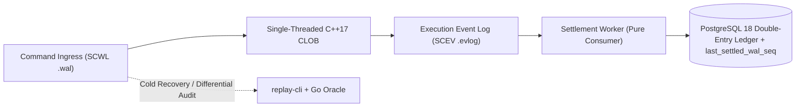

# ADR-006: Event-Sourced Core and Execution Event Log (`"SCEV"`)

- **Status:** Accepted
- **Date:** 2026-11-21
- **Scope:** `engine/`, `services/internal/engine/`, `services/cmd/settlement/`

## 1. Context

If the C++17 matching engine writes only the incoming **Command WAL** (`"SCWL"`, 64-byte records defined in [ADR-005](ADR-005-deterministic-wal-replay-and-merkle-solvency.md)), then settling fills asynchronously into PostgreSQL 18 requires `services/cmd/settlement` to replay the Command WAL through a second in-memory matching instance to re-derive fills, cancels, and price-improvement deltas.

Re-running matching inside the settlement consumer introduces two architectural weaknesses:
1. **Dual-Execution Coupling:** Production settlement correctness depends on two separate runtime instances (and potentially two code paths, C++ vs. Go) producing identical execution side effects under identical state.
2. **Auditability & Replay Separation:** Downstream consumers (settlement, market data persistence, order lifecycle telemetry) cannot observe what the matching engine actually decided without re-executing the full order book state machine.

## 2. Decision

1. **Event-Sourced Two-Journal Core (`SCWL` Input + `SCEV` Output):**
   - **Input Journal (`*.wal`, Magic `0x5343574C` = `"SCWL"`):** Records every state-mutating ingress command (`OP_SUBMIT_ORDER`, `OP_CANCEL_ORDER`, `OP_CANCEL_ALL_ACCOUNT`, `OP_UPDATE_MARK_PRICE`, `OP_SNAPSHOT_BARRIER`) before execution.
   - **Output Execution Event Log (`*.wal.evlog`, Magic `0x53434556` = `"SCEV"`):** Appends fixed 64-byte CRC32C-protected execution event records (`WalEventRecord`) for every deterministic output of the C++17 matching loop (`ORDER_ACCEPTED`, `TRADE_FILL`, `ORDER_CANCELED`, `ORDER_REJECTED`), tagged with the originating `wal_seq`.
2. **Pure Consumer Settlement (`services/cmd/settlement`):** `settlement` acts purely as an event consumer—never re-running matching—tailing `.evlog` frames strictly with `wal_seq > engine_checkpoints.last_settled_wal_seq`, translating fills/cancels/rejects into balanced double-entry PostgreSQL 18 journal rows (`ORDER_RESERVE -> TRADE_SETTLE / CANCEL_RELEASE`), and advancing `last_settled_wal_seq` atomically.
3. **C++17 C ABI Default & Go Reference Oracle:** `gateway` and `replay-cli` execute the C++17 engine by default via `cgo` (`libsettlecore_engine.a`). The pure-Go matching engine is retained behind `-tags goengine` strictly as a differential verification oracle (`services/internal/engine/differential_test.go`).

## 3. Exact Specification

### 3.1 Binary Execution Event Record (`"SCEV"`, 64 Bytes, Little-Endian)

Stored in `<wal_path>.evlog`, aligned to 64 bytes with Castagnoli CRC32C over bytes `[16..63]`:

```text
Offset   Size  Field            Description
[0..3]    4B   magic            0x53434556 ("SCEV", little-endian)
[4]       1B   version          1
[5]       1B   event_type       1=ORDER_ACCEPTED, 2=TRADE_FILL, 3=ORDER_CANCELED, 4=ORDER_REJECTED
[6..7]    2B   market_id        1=ETH/USDC, 2=BTC/USDC
[8]       1B   status           SC_STATUS_* (0..6)
[9]       1B   flags            bit0=side (0=BUY,1=SELL), bit1=maker_terminal, bit2=taker_terminal
[10..11]  2B   reserved         0x0000
[12..15]  4B   crc32c           Castagnoli CRC32C checksum over payload bytes [16..63]
[16..23]  8B   wal_seq          Originating input command WAL sequence number (uint64)
[24..31]  8B   order_id         Order ID (taker_order_id for TRADE_FILL) (uint64)
[32..39]  8B   maker_order_id   Resting maker order ID for TRADE_FILL, else 0 (uint64)
[40..47]  8B   trade_id         Monotonic trade ID for TRADE_FILL, else 0 (uint64)
[48..55]  8B   exec_price_1e8   Execution or limit price in 1e8 scale (int64)
[56..63]  8B   fill_qty_1e8     Filled, canceled, or accepted quantity in 1e8 scale (int64)
```

### 3.2 End-to-End Event-Sourced Pipeline



## 4. Alternatives Considered

1. **Re-Executing Matching Inside `settlement`:** Rejected. Re-running matching duplicates CPU work, risks state divergence if snapshots drift, and couples settlement to matching-engine internals.
2. **Publishing Execution Events Directly to Kafka/NATS Only:** Rejected. Adding an external broker introduces a two-phase commit gap between the C++17 CLOB and the broker. Writing a co-located binary `.evlog` file protected by CRC32C keeps the hot path self-contained and deterministic.

## 5. Trade-offs & Failure Modes

- **Disk Write Amplification:** Appending both a 64-byte `SCWL` input record and 64-byte `SCEV` output record(s) doubles sequential append bandwidth on disk. Both files are sequential, fixed-record-size, and amortized under `GROUP_COMMIT` (see [ADR-007](ADR-007-wal-durability-contract-and-group-commit.md)).
- **Torn Tail on `.evlog`:** Just like `.wal`, incomplete or corrupt trailing `< 64`-byte frames at EOF after a power loss are safely truncated on recovery; missing events for a committed `SCWL` command can be deterministically regenerated by replaying the command log from the last valid snapshot.
