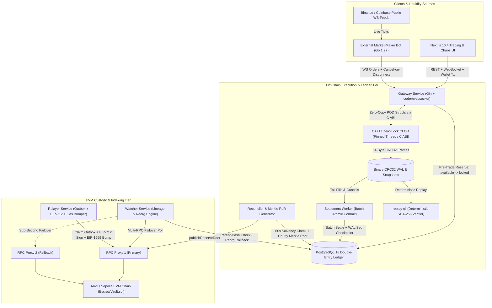

# SettleCore System Architecture

This document specifies the runtime topology, thread ownership, sequence flows, backpressure rules, and failure recovery protocols of SettleCore.

---

## 1. High-Level Topology & Thread Ownership

SettleCore separates sub-microsecond order matching from durable double-entry accounting and asynchronous EVM chain finality across seven Go 1.27 processes, an in-process C++17 matching engine linked via flat C ABI (`cgo`), a PostgreSQL 18 database, and an on-chain Solidity 0.8.38 `EscrowVault`.



### Thread & Process Model

| Process / Component | Concurrency Model | State Ownership |
| :--- | :--- | :--- |
| **`gateway` + `libsettlecore_engine.a`** | Multi-goroutine HTTP/WS ingress (`coder/websocket`) feeding a bounded ring buffer drained by **1 OS-pinned thread** (`runtime.LockOSThread()`) per market calling C++17 `sc_engine_submit`. | C++17 owns in-memory resting order book and active `.wal` append descriptor. |
| **`settlement`** | Single writer loop per market batching up to 256 WAL events or $5\,\text{ms}$ window. | Owns `engine_checkpoints`, `trades`, `orders.status` transitions (`OPEN -> FILLED/CANCELED`), and batch settlement `ledger_entries`. |
| **`watcher`** | Single block-sequencing loop backed by concurrent health probes in `rpc_pool.go`. | Owns `indexed_blocks` and `onchain_deposits` state transitions (`PENDING -> CONFIRMED / ORPHANED`). |
| **`relayer`** | Outbox poller (`FOR UPDATE SKIP LOCKED`) + strict serialized EOA nonce allocator + ticker loop for EIP-1559 stuck-transaction fee bumping. | Owns `withdrawal_outbox` and relayer EOA nonce sequence. |
| **`reconciler`** | 60-second invariant ticker + 3600-second Merkle tree builder (`REPEATABLE READ` snapshot). | Owns `merkle_snapshots` and `reserves_invariant_ok` Prometheus gauge. |
| **`market-maker`** | External, unprivileged client streaming public exchange ticks and quoting two-sided ladders over public Gateway WebSocket. | Zero database or internal memory access; relies on WebSocket Cancel-on-Disconnect. |

---

## 2. End-to-End Sequence Flows

### 2.1 Deposit Finality & Deterministic 3-Block Reorg Rollback

```mermaid
sequenceDiagram
    autonumber
    participant User as User Wallet
    participant Vault as EscrowVault.sol (Anvil)
    participant Proxy as RPC Failover Pool
    participant Watcher as Watcher Service
    participant DB as PostgreSQL 18 Ledger

    User->>Vault: depositERC20(USDC, 10000e6) [Block 101, Hash 0xA1]
    Watcher->>Proxy: eth_getBlockByNumber(101)
    Proxy-->>Watcher: Block 101 (hash=0xA1, parent=0xA0) + Deposit Log
    Watcher->>DB: INSERT indexed_blocks(101, 0xA1, 0xA0); INSERT onchain_deposits(PENDING, 0/3 confs)

    Note over Vault,Watcher: Blocks 102 (0xA2) and 103 (0xA3) mined (3 Confirmations Reached)
    Watcher->>DB: BEGIN; UPDATE onchain_deposits SET status='CONFIRMED'; INSERT ledger_entries (Debit VAULT, Credit User available +10,000 USDC); COMMIT

    Note over Vault,Watcher: CHAOS DRILL: 3-Block Reorg replaces Blocks 101..103 with Fork Blocks 101'..104'
    Watcher->>Proxy: eth_getBlockByNumber(104')
    Proxy-->>Watcher: Block 104' (parent=0xB3 != DB[103].hash 0xA3)
    Watcher->>Proxy: Walk backward 103', 102', 101', 100 (Common ancestor found at Block 100 = 0xA0)
    Watcher->>DB: BEGIN; Mark blocks 101..103 ORPHANED; Mark deposit ORPHANED; Post compensating Debit User / Credit VAULT (-10,000 USDC); COMMIT
    Watcher->>Watcher: Increment Prometheus counter reorg_rollbacks_total
```

### 2.2 Two-Phase Order Ingress, C++17 Matching, Batch Settlement & Crash Recovery

```mermaid
sequenceDiagram
    autonumber
    participant Client as Trader (REST / WS)
    participant GW as Gateway (Go 1.27)
    participant DB as PostgreSQL 18 Ledger
    participant CLOB as C++17 CLOB (C ABI)
    participant WAL as Binary CRC32 WAL
    participant Settle as Settlement Worker

    Client->>GW: POST /v1/orders (Idempotency-Key: uuid, BUY 2.0 ETH @ 3100 USDC)
    GW->>DB: BEGIN; Lock Account; Move 6206.20 USDC (notional + max fee) available -> locked; INSERT order(status='RESERVED'); COMMIT
    GW->>CLOB: cgo sc_engine_submit(sc_order_cmd_t)
    CLOB->>WAL: Append 64-byte CRC32 frame (wal_seq=40921, OP_SUBMIT_ORDER)
    CLOB->>CLOB: Match in-memory slab: Fill 1.5 ETH @ 3095 USDC (maker), Rest 0.5 ETH @ 3100 USDC
    CLOB-->>GW: Return sc_exec_report_t (PARTIALLY_FILLED, 1 fill)
    GW-->>Client: HTTP 201 Created + WS ExecutionReport (< 1.5 ms end-to-end; < 2 µs CLOB match)

    Settle->>WAL: Tail committed WAL frames (seq 40900..40921)
    Settle->>DB: BEGIN; SELECT accounts ORDER BY account_id ASC FOR UPDATE
    Settle->>DB: Debit Buyer locked USDC, Credit Seller available USDC; Debit Seller locked ETH, Credit Buyer available ETH; Credit Fee Treasury; UPDATE engine_checkpoints SET last_settled_wal_seq=40921; COMMIT
```

### 2.3 Tiered Withdrawal Outbox, EIP-712 Signing & EIP-1559 Stuck-Tx Gas Bumping

```mermaid
sequenceDiagram
    autonumber
    participant User as Trader UI
    participant GW as Gateway Service
    participant DB as PostgreSQL 18 Ledger
    participant Relayer as Relayer + Gas Bumper
    participant Vault as EscrowVault.sol

    User->>GW: POST /v1/withdrawals (asset=USDC, amount=5000, recipient=0xAbC...)
    GW->>DB: BEGIN; Lock Account; Move 5000 USDC available -> locked; INSERT withdrawal_outbox(status='QUEUED'); COMMIT
    Relayer->>DB: SELECT ... FROM withdrawal_outbox WHERE status='QUEUED' FOR UPDATE SKIP LOCKED
    Relayer->>Relayer: Evaluate Tier: 5,000 USDC <= hotPerTxCap & rolling 24h token-bucket budget -> Sign EIP-712 with HOT_SIGNER_KEY
    Relayer->>DB: Allocate serialized relayer EOA nonce=42; UPDATE status='SUBMITTED', tx_hash=0x111...
    Relayer->>Vault: Broadcast EIP-1559 withdraw(voucher, hotSig, emptyColdSig) [nonce=42, maxFee=20 gwei]

    Note over Relayer,Vault: CHAOS DRILL: BaseFee spikes 10x to 150 gwei; Tx 0x111 unmined after 12s
    Relayer->>Relayer: gas_bumper detects stuck nonce=42; Re-signs replacement tx at nonce=42 with maxFee=310 gwei (+15% priority fee)
    Relayer->>Vault: Broadcast Replacement Tx 0x222 [nonce=42] & increment stuck_tx_gas_bumps
    Vault-->>Relayer: Receipt Confirmed (WithdrawalExecuted event)
    Relayer->>DB: BEGIN; Debit User locked 5000 USDC, Credit SYSTEM_ESCROW_VAULT; UPDATE withdrawal_outbox status='CONFIRMED'; COMMIT
```

### 2.4 External Market-Maker & WebSocket Cancel-on-Disconnect

```mermaid
sequenceDiagram
    autonumber
    participant Feed as Binance Public WS
    participant MM as Market-Maker Bot
    participant GW as Gateway WS Hub
    participant CLOB as C++17 CLOB
    participant Settle as Settlement Worker

    MM->>GW: WS Connect /v1/ws (Enable Cancel-on-Disconnect session flag)
    Feed-->>MM: ETHUSDT Best Bid/Ask Tick (3099.50 / 3100.50)
    MM->>GW: Batch Submit 10 Bid + 10 Ask Limit Orders (spread=8 bps)
    GW->>CLOB: sc_engine_submit x 20

    Note over MM,GW: Network drop or Market-Maker process crash (TCP FIN / 3s heartbeat timeout)
    GW->>CLOB: Automatic sc_engine_submit(OP_CANCEL_ALL_ACCOUNT, account_id=MM)
    CLOB->>CLOB: O(K) intrusive removal of all resting MM orders; emit cancel report batch
    Settle->>Settle: Release all remaining MM locked balances back to available
```

---

## 3. Backpressure & Overload Shedding Rules

1. **CLOB Ingress Ring Channel (`capacity = 65,536`):** If a burst of orders saturates the C ABI dispatch channel beyond 85% capacity, the Gateway rejects non-cancel requests with HTTP `429 Too Many Requests` (`ERR_ENGINE_BACKPRESSURE`) while reserving priority capacity for `OP_CANCEL_ORDER` and `OP_CANCEL_ALL_ACCOUNT` so market makers can always reduce risk.
2. **WebSocket Outbound Fan-Out (`coder/websocket`):** Each connected WebSocket client has a bounded outbound ring buffer (`512` frames). L2 depth diffs coalesce per $25\,\text{ms}$ tick window; if a slow consumer still falls behind, the hub disconnects the socket with close code `1008 Policy Violation (Slow Consumer)` and triggers Cancel-on-Disconnect if armed.
3. **Database Connection Pool (`pgxpool`):** Capped at `64` connections for `gateway` and `16` connections for `settlement`. Pre-trade reservation timeouts are bounded at `250ms` via `context.WithTimeout`.

---

## 4. Failure-Mode & Recovery Matrix

| Failure Scenario | Detection Mechanism | Automated Recovery Action | Invariant Preserved |
| :--- | :--- | :--- | :--- |
| **Gateway crash after DB `RESERVED`, before CLOB WAL write** | Startup reconciliation queries `orders WHERE status = 'RESERVED'` and checks `wal_seq` presence in WAL. | Roll back unsubmitted `RESERVED` orders (`locked -> available`, `status = 'ABORTED_UNSUBMITTED'`). | Double-Entry Conservation |
| **Gateway crash after CLOB WAL write, before Batch Settlement** | `settlement` reads `engine_checkpoints.last_settled_wal_seq` and replays WAL frames `> last_settled_wal_seq`. | Re-constructs C++17 order book from latest snapshot + WAL tail and settles unapplied fills idempotently. | Deterministic Replay & Conservation |
| **Primary EVM RPC outage or rate limit (`429` / TCP drop)** | `rpc_pool.go` health probe or request error threshold ($>2$ failures or $>2$ blocks head lag). | Switches active provider to `EVM_FALLBACK_RPC_URL` (`rpc-proxy-2`) in $<500\,\text{ms}$ without dropping cursor. | Zero Missed Blocks |
| **EVM chain reorganization ($\le 64$ blocks)** | `watcher` detects `block.parentHash != indexed_blocks[H-1].blockHash`. | Walks backward to common ancestor, marks orphaned blocks/deposits, posts compensating double-entry debit. | Reorg Safety |
| **Stuck withdrawal transaction during baseFee spike** | `relayer` observes `status = 'SUBMITTED'` unmined for $> 12\,\text{s}$. | Re-broadcasts replacement tx at identical EOA nonce with $+15\%$ bumped EIP-1559 fee caps. | Nonce Monotonicity |
| **Flash crash ($> 10\%$ mark price deviation)** | C++17 `circuit_breaker.cpp` compares aggressive execution price against reference mark price. | Halts aggressive matching on affected pair (`SC_ERR_CIRCUIT_BREAKER_TRIPPED`), accepts cancels only. | Market Integrity |
