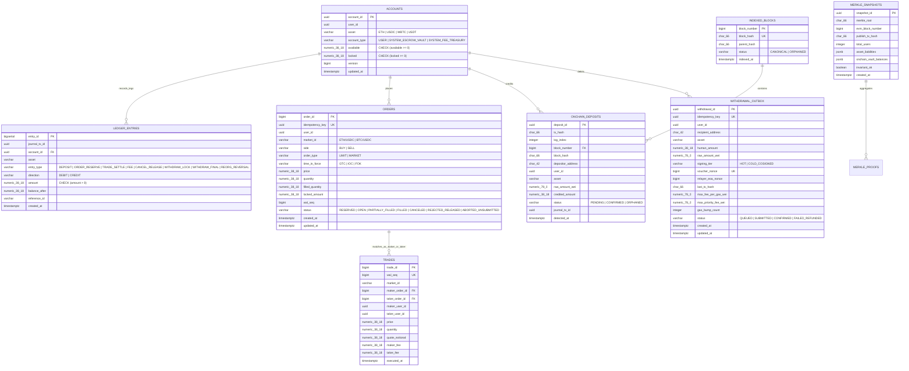

# SettleCore PostgreSQL 18 Database Schema Specification

SettleCore uses **PostgreSQL 18** (`postgres:18-alpine`) as its system of record for double-entry accounting, two-phase order reservation, EVM block lineage tracking, transactional withdrawal outbox, and Merkle Proof-of-Reserves auditing.

All SQL queries are compiled into type-safe Go 1.27 code via `sqlc` (`services/sqlc.yaml`) with strict `NUMERIC -> github.com/shopspring/decimal.Decimal` overrides (zero `float64`).

---

## 1. Entity-Relationship Diagram



---

## 2. Planned Migration DDL Specifications

### 2.1 Migration `000001_init_ledger_and_accounts.up.sql`

```sql
CREATE TABLE accounts (
    account_id   UUID PRIMARY KEY,
    user_id      UUID NOT NULL,
    asset        VARCHAR(16) NOT NULL CHECK (asset IN ('ETH', 'USDC', 'WBTC', 'USDT')),
    account_type VARCHAR(32) NOT NULL CHECK (account_type IN ('USER', 'SYSTEM_ESCROW_VAULT', 'SYSTEM_FEE_TREASURY')),
    available    NUMERIC(38, 18) NOT NULL DEFAULT 0,
    locked       NUMERIC(38, 18) NOT NULL DEFAULT 0,
    version      BIGINT NOT NULL DEFAULT 1,
    created_at   TIMESTAMPTZ NOT NULL DEFAULT NOW(),
    updated_at   TIMESTAMPTZ NOT NULL DEFAULT NOW(),
    CONSTRAINT uq_accounts_user_asset UNIQUE (user_id, asset, account_type),
    CONSTRAINT chk_accounts_non_negative_user CHECK (
        account_type = 'SYSTEM_ESCROW_VAULT' OR (available >= 0 AND locked >= 0)
    )
);

CREATE INDEX idx_accounts_user_id ON accounts (user_id);

CREATE TABLE ledger_entries (
    entry_id       BIGSERIAL PRIMARY KEY,
    journal_tx_id  UUID NOT NULL,
    account_id     UUID NOT NULL REFERENCES accounts (account_id),
    asset          VARCHAR(16) NOT NULL CHECK (asset IN ('ETH', 'USDC', 'WBTC', 'USDT')),
    entry_type     VARCHAR(32) NOT NULL CHECK (
        entry_type IN (
            'DEPOSIT',
            'ORDER_RESERVE',
            'TRADE_SETTLE',
            'FEE',
            'CANCEL_RELEASE',
            'WITHDRAW_LOCK',
            'WITHDRAW_FINAL',
            'REORG_REVERSAL'
        )
    ),
    direction      VARCHAR(8) NOT NULL CHECK (direction IN ('DEBIT', 'CREDIT')),
    amount         NUMERIC(38, 18) NOT NULL CHECK (amount > 0),
    balance_after  NUMERIC(38, 18) NOT NULL,
    reference_id   VARCHAR(128) NOT NULL,
    created_at     TIMESTAMPTZ NOT NULL DEFAULT NOW()
);

CREATE INDEX idx_ledger_entries_journal_tx ON ledger_entries (journal_tx_id);
CREATE INDEX idx_ledger_entries_account_created ON ledger_entries (account_id, created_at DESC);
CREATE INDEX idx_ledger_entries_reference ON ledger_entries (reference_id);

-- Append-only ledger immutability + deferred double-entry conservation enforcement
CREATE TRIGGER trg_ledger_entries_immutable
    BEFORE UPDATE OR DELETE ON ledger_entries
    FOR EACH ROW
    EXECUTE FUNCTION fn_ledger_entries_immutable();

CREATE CONSTRAINT TRIGGER trg_ledger_entries_balanced
    AFTER INSERT ON ledger_entries
    DEFERRABLE INITIALLY DEFERRED
    FOR EACH ROW
    EXECUTE FUNCTION fn_ledger_entries_balanced();
```

### 2.2 Migration `000002_init_evm_indexing_and_outbox.up.sql`

```sql
CREATE TABLE indexed_blocks (
    block_number BIGINT NOT NULL,
    block_hash   CHAR(66) PRIMARY KEY,
    parent_hash  CHAR(66) NOT NULL,
    status       VARCHAR(16) NOT NULL DEFAULT 'CANONICAL' CHECK (status IN ('CANONICAL', 'ORPHANED')),
    indexed_at   TIMESTAMPTZ NOT NULL DEFAULT NOW()
);

CREATE UNIQUE INDEX uq_indexed_blocks_canonical_height
    ON indexed_blocks (block_number)
    WHERE status = 'CANONICAL';

CREATE TABLE onchain_deposits (
    deposit_id        UUID PRIMARY KEY,
    tx_hash           CHAR(66) NOT NULL,
    log_index         INTEGER NOT NULL CHECK (log_index >= 0),
    block_number      BIGINT NOT NULL,
    block_hash        CHAR(66) NOT NULL REFERENCES indexed_blocks (block_hash),
    depositor_address CHAR(42) NOT NULL,
    user_id           UUID NOT NULL,
    asset             VARCHAR(16) NOT NULL CHECK (asset IN ('ETH', 'USDC', 'WBTC', 'USDT')),
    raw_amount_wei    NUMERIC(78, 0) NOT NULL CHECK (raw_amount_wei > 0),
    credited_amount   NUMERIC(38, 18) NOT NULL CHECK (credited_amount > 0),
    status            VARCHAR(16) NOT NULL DEFAULT 'PENDING' CHECK (status IN ('PENDING', 'CONFIRMED', 'ORPHANED')),
    journal_tx_id     UUID,
    detected_at       TIMESTAMPTZ NOT NULL DEFAULT NOW(),
    confirmed_at      TIMESTAMPTZ,
    CONSTRAINT uq_onchain_deposits_tx_log_block UNIQUE (tx_hash, log_index, block_hash)
);

CREATE INDEX idx_onchain_deposits_pending_height
    ON onchain_deposits (block_number)
    WHERE status = 'PENDING';

CREATE TABLE withdrawal_outbox (
    withdrawal_id        UUID PRIMARY KEY,
    idempotency_key      UUID NOT NULL UNIQUE,
    user_id              UUID NOT NULL,
    recipient_address    CHAR(42) NOT NULL,
    asset                VARCHAR(16) NOT NULL CHECK (asset IN ('ETH', 'USDC', 'WBTC', 'USDT')),
    human_amount         NUMERIC(38, 18) NOT NULL CHECK (human_amount > 0),
    raw_amount_wei       NUMERIC(78, 0) NOT NULL CHECK (raw_amount_wei > 0),
    signing_tier         VARCHAR(16) NOT NULL CHECK (signing_tier IN ('HOT', 'COLD_COSIGNED')),
    voucher_nonce        BIGINT NOT NULL UNIQUE,
    relayer_eoa_nonce    BIGINT,
    last_tx_hash         CHAR(66),
    max_fee_per_gas_wei  NUMERIC(78, 0),
    max_priority_fee_wei NUMERIC(78, 0),
    gas_bump_count       INTEGER NOT NULL DEFAULT 0 CHECK (gas_bump_count >= 0),
    status               VARCHAR(24) NOT NULL DEFAULT 'QUEUED' CHECK (
        status IN ('QUEUED', 'SUBMITTED', 'CONFIRMED', 'FAILED_REFUNDED')
    ),
    created_at           TIMESTAMPTZ NOT NULL DEFAULT NOW(),
    updated_at           TIMESTAMPTZ NOT NULL DEFAULT NOW()
);

CREATE INDEX idx_withdrawal_outbox_poll
    ON withdrawal_outbox (status, created_at ASC)
    WHERE status IN ('QUEUED', 'SUBMITTED');
```

### 2.3 Migration `000003_init_orders_trades_and_merkle.up.sql`

```sql
CREATE TABLE engine_checkpoints (
    market_id            VARCHAR(16) PRIMARY KEY CHECK (market_id IN ('ETH/USDC', 'BTC/USDC')),
    last_settled_wal_seq BIGINT NOT NULL DEFAULT 0 CHECK (last_settled_wal_seq >= 0),
    updated_at           TIMESTAMPTZ NOT NULL DEFAULT NOW()
);

CREATE TABLE orders (
    order_id        BIGINT PRIMARY KEY,
    idempotency_key UUID NOT NULL UNIQUE,
    user_id         UUID NOT NULL,
    market_id       VARCHAR(16) NOT NULL CHECK (market_id IN ('ETH/USDC', 'BTC/USDC')),
    side            VARCHAR(4) NOT NULL CHECK (side IN ('BUY', 'SELL')),
    order_type      VARCHAR(8) NOT NULL CHECK (order_type IN ('LIMIT', 'MARKET')),
    time_in_force   VARCHAR(4) NOT NULL CHECK (time_in_force IN ('GTC', 'IOC', 'FOK')),
    price           NUMERIC(38, 18) NOT NULL CHECK (price >= 0),
    quantity        NUMERIC(38, 18) NOT NULL CHECK (quantity > 0),
    filled_quantity NUMERIC(38, 18) NOT NULL DEFAULT 0 CHECK (filled_quantity >= 0 AND filled_quantity <= quantity),
    locked_amount   NUMERIC(38, 18) NOT NULL CHECK (locked_amount >= 0),
    wal_seq         BIGINT,
    status          VARCHAR(24) NOT NULL CHECK (
        status IN (
            'RESERVED',
            'OPEN',
            'PARTIALLY_FILLED',
            'FILLED',
            'CANCELED',
            'REJECTED_RELEASED',
            'ABORTED_UNSUBMITTED'
        )
    ),
    created_at      TIMESTAMPTZ NOT NULL DEFAULT NOW(),
    updated_at      TIMESTAMPTZ NOT NULL DEFAULT NOW()
);

CREATE INDEX idx_orders_user_active
    ON orders (user_id, market_id, created_at DESC)
    WHERE status IN ('RESERVED', 'OPEN', 'PARTIALLY_FILLED');

CREATE TABLE trades (
    trade_id       BIGINT PRIMARY KEY,
    wal_seq        BIGINT NOT NULL UNIQUE,
    market_id      VARCHAR(16) NOT NULL CHECK (market_id IN ('ETH/USDC', 'BTC/USDC')),
    maker_order_id BIGINT NOT NULL REFERENCES orders (order_id),
    taker_order_id BIGINT NOT NULL REFERENCES orders (order_id),
    maker_user_id  UUID NOT NULL,
    taker_user_id  UUID NOT NULL,
    price          NUMERIC(38, 18) NOT NULL CHECK (price > 0),
    quantity       NUMERIC(38, 18) NOT NULL CHECK (quantity > 0),
    quote_notional NUMERIC(38, 18) NOT NULL CHECK (quote_notional > 0),
    maker_fee      NUMERIC(38, 18) NOT NULL DEFAULT 0 CHECK (maker_fee >= 0),
    taker_fee      NUMERIC(38, 18) NOT NULL DEFAULT 0 CHECK (taker_fee >= 0),
    executed_at    TIMESTAMPTZ NOT NULL DEFAULT NOW()
);

CREATE INDEX idx_trades_market_executed ON trades (market_id, executed_at DESC);

CREATE TABLE merkle_snapshots (
    snapshot_id            UUID PRIMARY KEY,
    merkle_root            CHAR(66) NOT NULL UNIQUE,
    evm_block_number       BIGINT NOT NULL,
    publish_tx_hash        CHAR(66),
    total_users            INTEGER NOT NULL CHECK (total_users >= 0),
    asset_liabilities      JSONB NOT NULL,
    onchain_vault_balances JSONB NOT NULL,
    invariant_ok           BOOLEAN NOT NULL,
    created_at             TIMESTAMPTZ NOT NULL DEFAULT NOW()
);
```
